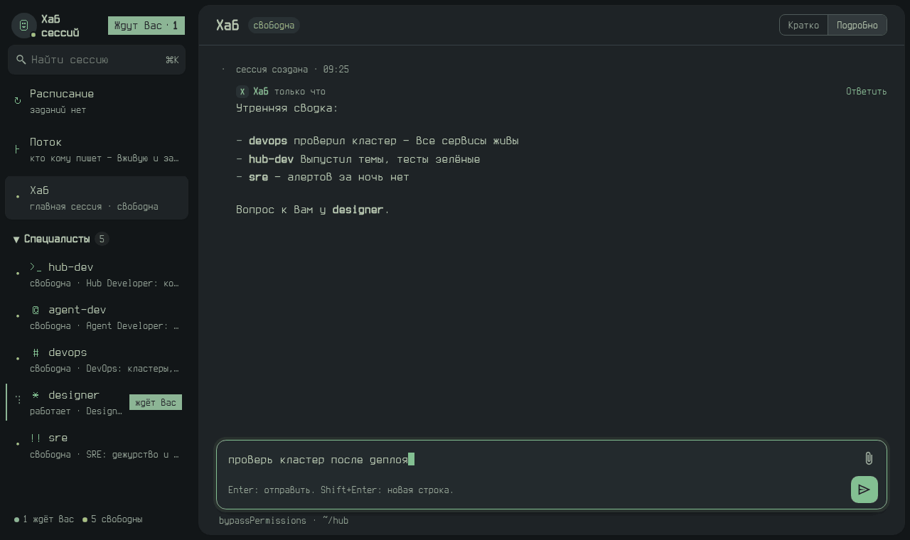
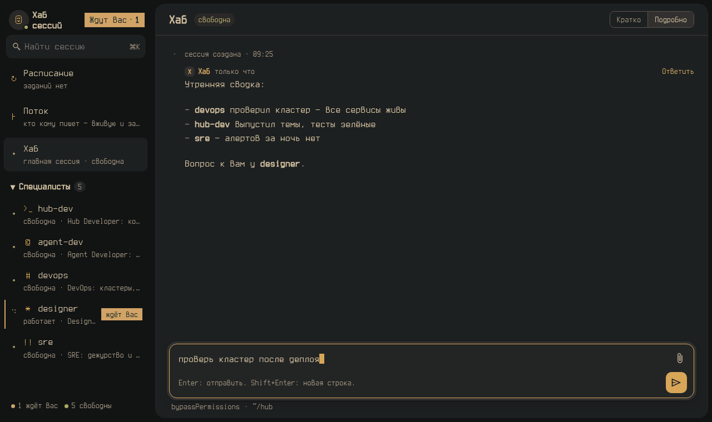

# Unix terminal: Agents Hub themes

Two dark themes in the spirit of the terminals of the 70s and 80s. Choose one in Settings → Look.

**Calm phosphor**: a green palette after Everforest:

**Calm amber**: an amber palette after Gruvbox:

- The Terminus font on the whole page: the feed, the lists, code (`"font_scope": "all"`), larger (`"font_scale"`, to
  match the hub's default text size): exactly 18px, as in a console.
- Hub icons and agent avatars are pixel pictures of Terminus glyphs: ☺ ↻ ├ /, for agents `>_` @ # !! *.
  About 80 more common session emoji (📦 🔎 🤖 🚀 🐛 …) are Terminus glyphs too.
- Every other emoji (the whole Unicode list, about 1900, with skin tones, sequences and flags) is a single special
  character or a Terminus box-drawing glyph (🦊 ω, 🐙 Σ, 🌵 ¡): the character is picked by the meaning of the group and
  fixed to the emoji, so a new session with any emoji gets a glyph at once, without editing the theme.
- All these glyphs are built into the theme font, **Hub Term Emoji, based on Terminus (OFL)**: emoji in the session
  list, in "Flow" and in message text are drawn with the theme's glyphs.
- A calm "waits for you" and the theme colors everywhere: the "waits for you", "answer?" and "Waiting for you · N" tags
  are inverse, like a terminal status line (a block of the theme's attention color, text in the background color),
  not a pink fill; a session that waits for you gets a straight bar; feed participants and menu icons use the theme
  color, not a hue by name. The style (`web/style.css`) is on only with a unix theme chosen (this plugin's or your own
  named "Unix ·…"); with "System" and other themes the hub looks as usual.
- The selected session in the list is not inverted: a plate in the "muted" background color, a bar on the left and the
  name in the theme's attention color, square corners (no rounding); "Waiting for you" with a long caption has no solid
  block, the tag and icons read as on the other rows.
  The selected row has no focus ring (the plate with the bar already shows the choice); other rows show keyboard focus
  as a thin 1px border at the edge.
- The caret in input fields is a blinking block in the theme color, as in a terminal (in Chrome with `caret-shape`;
  where it is missing, a regular thin caret in the theme color; with "reduce motion" in the system it does not blink).
- The "send" button is the ↲ glyph in the theme font instead of the paper plane: flat, with a thin border, inverse on
  hover; "stop" has square corners.
- The "Requests to the hub" stickers (the hub-requests plugin) in the theme's flat look: no shadows or animation, a 1px
  border, a ready answer in the inverse attention color, long in progress dashed; the text in the theme font.
  An open sticker slides out to the left of the tab column; session icons on the tabs are centered (the theme font
  glyphs were rebuilt: the glyph offset equals the left edge of the outline).
- A flat frame, also only with a unix theme: columns to the window edges, square corners, thin lines between the
  columns, small rounding inside, no extra outlines.

Needs a hub with Plugin API 1.8 (the whole-page font and scale fields:
[PR #28](https://github.com/flagman/agents-hub-core/pull/28), already in the shared hub). On an older hub the theme
installs with an "update the hub" note: the colors and icons work, but Terminus is used only in headings and smaller.

The Terminus and Hub Term Emoji (derived from Terminus) fonts are under SIL OFL 1.1 (`themes/f/terminus-COPYING.txt`).
The theme JSON and pictures are MIT.

The flat frame is based on [hub-plugin-flat](https://github.com/flagman/hub-plugin-flat) (MIT, © 2026 flagman), its
license text is in `LICENSE-flat`.
